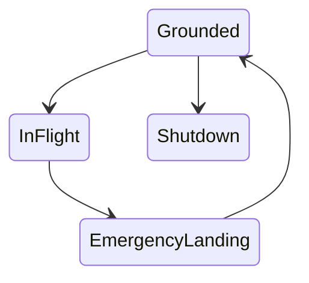
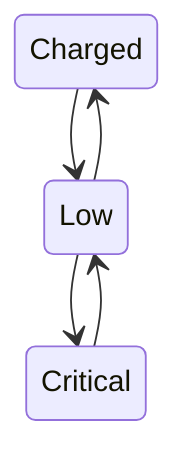
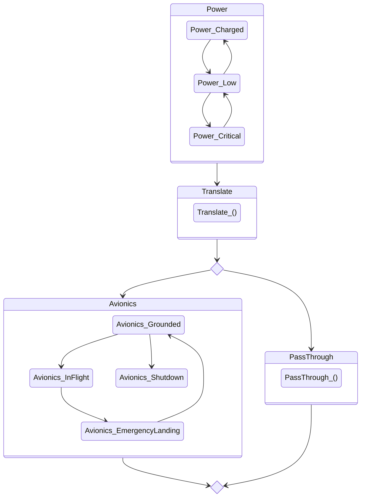

# Diagramas gerados pelo módulo Render do CREM

Gerados por `cabal run` em `others/avionics-crem` (`Avionics.Diagram`). Texto Mermaid conferido; não foi renderizado por ferramenta Mermaid nesta máquina.

## Aviônica (topologia)

Não há aresta `InFlight --> Shutdown`. As auto-transições não aparecem porque a aresta identidade é implícita.

## Energia (topologia)

## Composição acoplada (energia -> tradução -> aviônica), via renderFlow

